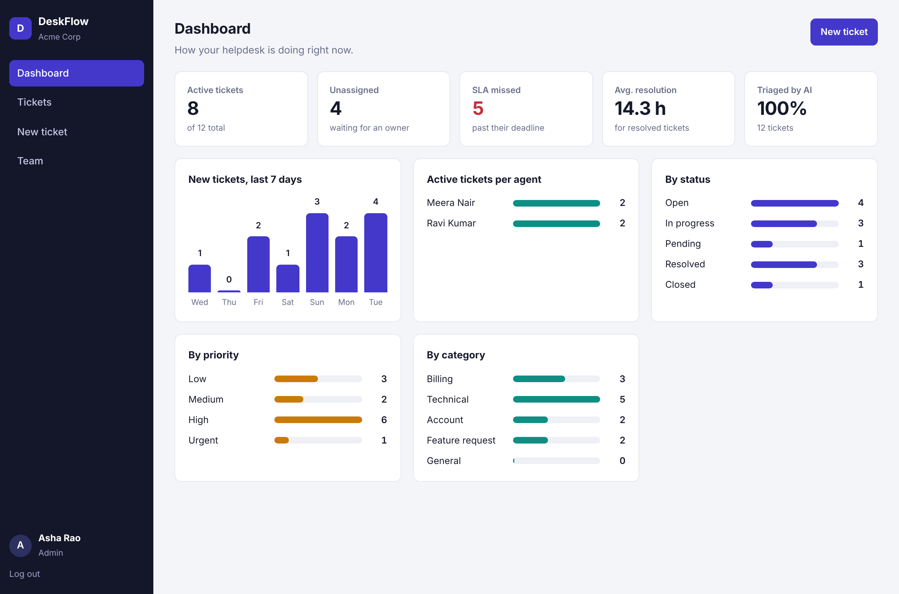
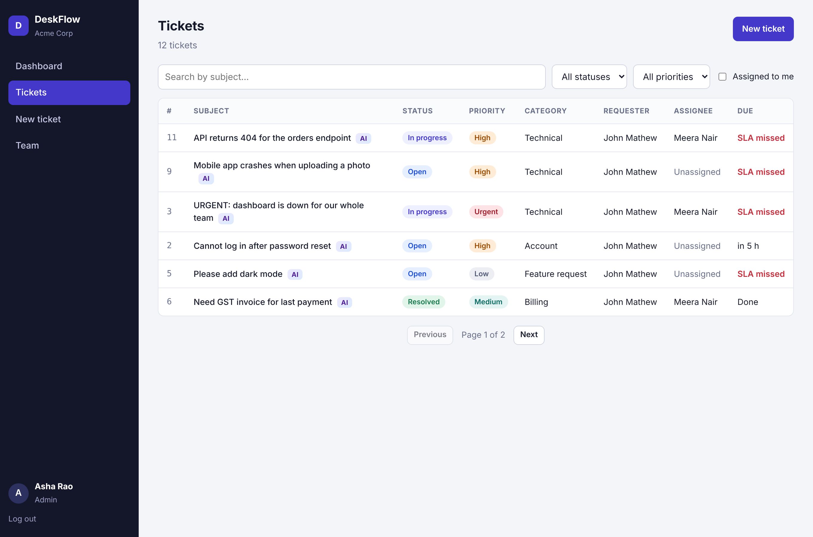
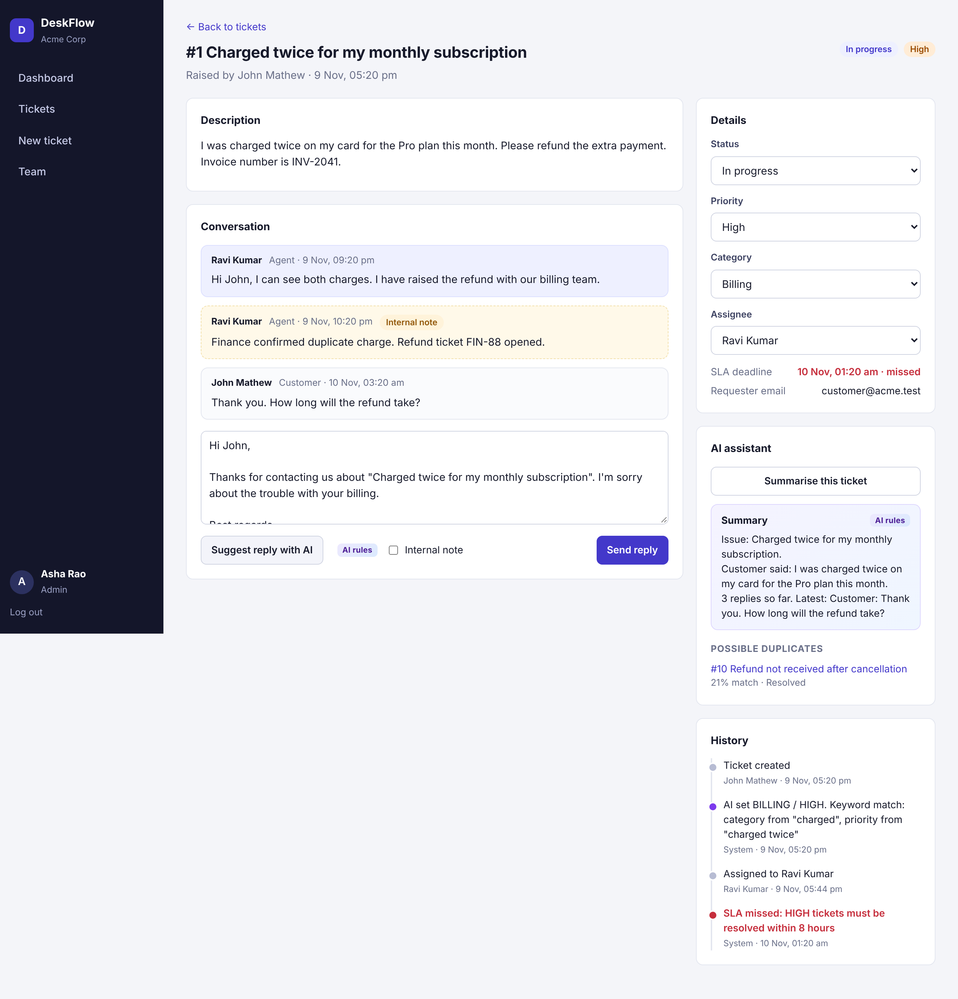
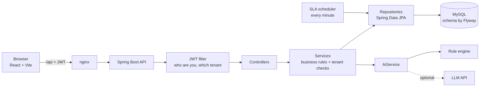

# DeskFlow Lite

A multi-tenant helpdesk (support ticket system) with AI-assisted triage.
Many companies share one application and one database, and each company sees only its own data.

**Stack:** Java 17 · Spring Boot 3 · Spring Security (JWT) · Spring Data JPA · MySQL 8 · Flyway · React 18 · Vite · Docker



| Ticket list | Ticket detail with AI tools |
|---|---|
|  |  |

## What it does

- **Multi-tenancy.** A company signs up and gets its own workspace. Every table has a `tenant_id`, and every query filters on the tenant taken from the signed JWT, so one company can never read another's tickets.
- **Three roles.** Admins manage the team, agents work on tickets, customers raise tickets and see only their own.
- **Ticket lifecycle.** Open → In progress → Pending → Resolved → Closed, with assignment, replies, private internal notes, and a full history of every change.
- **SLA tracking.** Each priority has a deadline (Urgent 4 h, High 8 h, Medium 24 h, Low 72 h). A background job flags tickets that miss it.
- **AI triage.** A new ticket gets its category and priority set automatically, with the reason shown.
- **AI reply drafts and summaries.** Agents get a suggested reply and a short summary of long threads.
- **Duplicate detection.** Each ticket shows similar tickets, scored with Jaccard similarity.
- **Dashboard.** Active tickets, SLA misses, average resolution time, workload per agent, and a 7-day trend.

### How the AI works

All AI features sit behind one interface, `AiService`, with two engines:

| Engine | When it is used | Needs |
|---|---|---|
| Rule engine (`RuleBasedAi`) | Default, and the fallback whenever the LLM fails | Nothing. Runs offline. |
| LLM (`LlmClient`) | When `AI_API_KEY` is set | Any OpenAI-compatible API (Groq, OpenAI, a local Ollama server) |

If the LLM is slow, down, or returns something invalid, the app quietly falls back to the rule engine. Creating a ticket never fails because of AI. The UI labels every AI answer with which engine produced it.

## Architecture



## Run it

### Option 1: Docker (easiest)

You need Docker Desktop.

```bash
docker compose up --build
```

Open <http://localhost:3000>. The first build downloads dependencies and takes a few minutes.

### Option 2: Run locally for development

You need Java 17+, Maven, Node 18+, and MySQL 8 running on port 3306.

```bash
# Terminal 1 - backend (http://localhost:8080)
cd backend
# Windows PowerShell:  $env:DB_PASSWORD="your-mysql-root-password"
export DB_PASSWORD=your-mysql-root-password
mvn spring-boot:run

# Terminal 2 - frontend (http://localhost:5173)
cd frontend
npm install
npm run dev
```

The database `deskflow` and all tables are created automatically on first start.

### Demo accounts

Created on first start. Password for all of them: `Password@123`

| Email | Role | Company |
|---|---|---|
| admin@acme.test | Admin | Acme Corp |
| agent@acme.test | Agent | Acme Corp |
| customer@acme.test | Customer | Acme Corp |
| admin@globex.test | Admin | Globex Ltd |

To see tenant isolation, log in as the Acme admin and then as the Globex admin: each sees a completely different set of tickets. Set `SEED_DEMO=false` to start with an empty database.

### Turn on the LLM (optional)

Copy `.env.example` to `.env`, put your key in `AI_API_KEY`, and restart. Without a key, everything still works using the rule engine.

## API

Swagger UI: <http://localhost:8080/swagger-ui.html> (log in through `/api/auth/login`, then paste the token into **Authorize**).

| Method | Path | Who | What |
|---|---|---|---|
| POST | `/api/auth/register-org` | anyone | Create a company and its first admin |
| POST | `/api/auth/login` | anyone | Get a JWT |
| GET | `/api/auth/me` | logged in | Current user |
| GET | `/api/tickets` | logged in | List with filters `status`, `priority`, `q`, `mine`, `page`, `size` |
| POST | `/api/tickets` | logged in | Create (AI fills priority/category if left empty) |
| GET | `/api/tickets/{id}` | logged in | Ticket with replies and history |
| PATCH | `/api/tickets/{id}` | admin, agent | Change status, priority, category, assignee |
| POST | `/api/tickets/{id}/comments` | logged in | Reply, or internal note (staff only) |
| GET | `/api/tickets/{id}/similar` | admin, agent | Possible duplicates |
| POST | `/api/tickets/{id}/ai/reply` | admin, agent | Draft a reply |
| POST | `/api/tickets/{id}/ai/summary` | admin, agent | Summarise the thread |
| POST | `/api/ai/triage` | logged in | Preview category and priority for some text |
| GET | `/api/dashboard` | admin, agent | Statistics |
| GET / POST | `/api/users` | admin | List and add team members |
| PATCH | `/api/users/{id}/active` | admin | Activate or deactivate a user |

## Project layout

```
backend/src/main/java/com/vivek/deskflow/
  auth/        sign-up and login
  security/    JWT creation, the request filter, security rules
  tenant/      the Tenant (company) entity
  user/        users, roles, team management
  ticket/      tickets, comments, history, SLA job
  ai/          AiService, rule engine, LLM client, similarity
  dashboard/   statistics
  seed/        demo data
  common/      error handling, pagination, Swagger config
backend/src/main/resources/db/migration/   Flyway SQL (the database schema)
frontend/src/
  api.js       every backend call
  auth.jsx     logged-in user state
  pages/       one file per screen
  components/  layout and shared UI pieces
```

## Tests

```bash
cd backend
mvn test
```

Unit tests cover the rule engine, the similarity maths, JWT creation and rejection, and the LLM fallback. They need no database.

## Design decisions

- **Shared database with a `tenant_id` column** rather than a database per tenant: cheapest to run and simplest to migrate. The trade-off is that isolation depends on the code, so every repository method takes the tenant id and it only ever comes from the JWT.
- **404 instead of 403** when a user asks for a ticket they may not see, so ticket ids cannot be probed.
- **Flyway owns the schema** (`ddl-auto=none`). Database changes are versioned SQL files, reviewed like code.
- **Stateless JWT auth.** No server session, so the API can run as several copies behind a load balancer.
- **AI behind an interface with a fallback.** The feature works with no key, and an AI outage cannot take the helpdesk down.
- **DTOs (Java records) at the API boundary.** Entities and password hashes never leave the server.

## Known limits and next steps

- A deactivated user's token keeps working until it expires (up to 8 hours). Fix: check the user on each request or keep a token deny-list.
- No refresh tokens, password reset, or email notifications yet.
- Dashboard counts are computed in Java from the tenant's tickets. At scale these become `GROUP BY` queries or a cached summary.
- Similarity is word overlap. The next step is embeddings with a vector index.
- No rate limiting on login or the AI endpoints.
